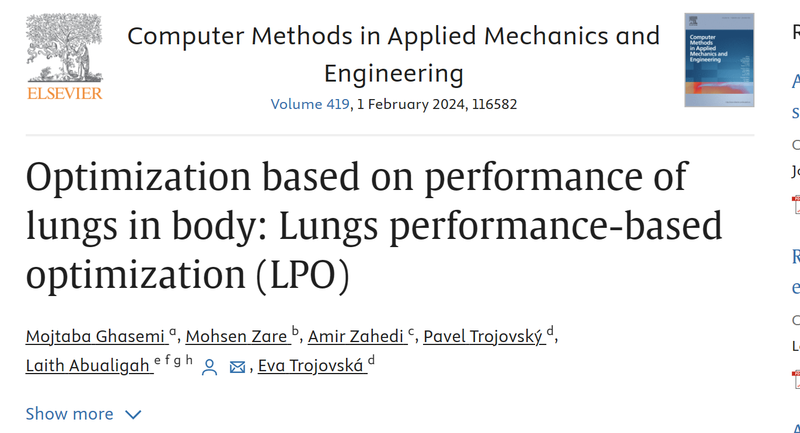

# [2024 Algorithm] Optimization of Pulmonary Function Based on Human Body: Pulmonary Function Optimization Algorithm (LPO) (Matlab Code Implementation)

[2024 Algorithm]Optimization of Pulmonary Function Based on Human Body: Pulmonary Function Optimization Algorithm (LPO) (Matlab Code Implementation)

## Images

<!-- PAYMENT_BLOCK -->

## Get this dataset

- Payment link (Stripe): [Buy now](https://buy.stripe.com/3cs8yP7sY87d0vu9AB)
- Payment QR code: 

<!-- /PAYMENT_BLOCK -->
